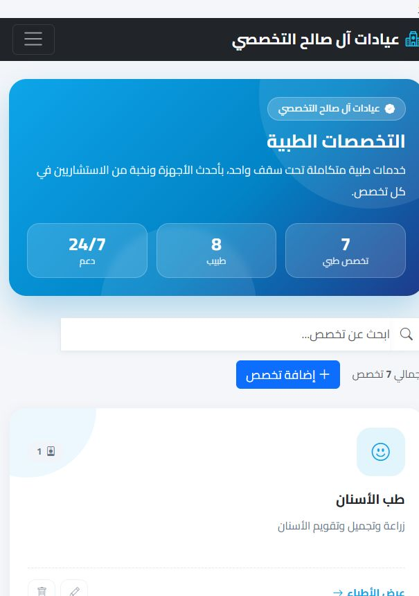
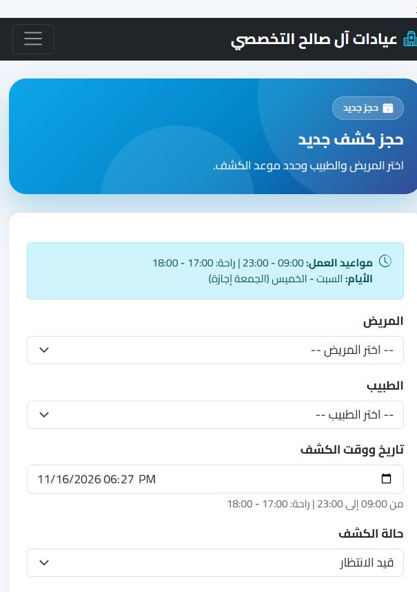

# 🏥 عيادات آل صالح التخصصي — ASP.NET Core MVC


[](https://github.com/bodysale5678az-svg/hospital/actions/workflows/ci.yml)


A complete **clinic management system** built with **ASP.NET Core MVC** and **Entity Framework Core**, featuring a full Arabic RTL dashboard for managing specializations, doctors, patients and appointments — with **working-hours validation** and **double-booking prevention**.

---

## 📸 Screenshots

### Reception dashboard


### Specializations


### Doctors


### Booking with working-hours validation


---

## ✨ Features

- 🩺 **Specializations** — full CRUD with doctor counts per specialization
- 👨‍⚕️ **Doctors** — CRUD with specialization dropdown, consultation fee and photo support
- 🧑‍🤝‍🧑 **Patients** — CRUD with age, gender and appointment history
- 📅 **Appointments** — CRUD with doctor/patient dropdowns and colored status badges
- 🕐 **Working Hours** — configurable open/close times, break time and working days
- 🚫 **Smart Validation** — blocks appointments:
  - outside working hours
  - on holidays (Friday)
  - during break time
  - in the past
  - duplicated for the same doctor and time
- 📊 **Reception Dashboard** — live stats, today's appointments and latest bookings
- 🔍 **Live Search** — instant filtering on specializations, doctors and patients
- 🌐 **Full Arabic RTL UI** — Cairo font, responsive sidebar, mobile-friendly

---

## 🗄️ Data Model

```
Specialization 1 ──── * Doctor 1 ──── * Appointment * ──── 1 Patient
                                            │
                                     ClinicSettings (1 row)
                                  open/close · break · days
```

- **Specialization → Doctor** : one-to-many
- **Doctor → Appointment** : one-to-many
- **Patient → Appointment** : one-to-many
- **ClinicSettings** : singleton configuration row for working hours

---

## 🏗️ Project Structure

```
hospital/
├── Controllers/     → Home, Specialization, Doctor, Patient, Appointments
├── Models/          → Specialization, Doctor, Patient, Appointment, ClinicSettings
├── Data/            → ApplicationDbContext
├── Views/           → Razor views (Arabic RTL)
├── Migrations/      → EF Core migrations
└── wwwroot/         → CSS, JS, Bootstrap
```

---

## 🛠️ Tech Stack


---

## 🚀 Getting Started

```bash
# 1. Configure your connection string in appsettings.json
# 2. Apply migrations
dotnet ef database update

# 3. Run
dotnet run
```

Default connection string:
```
Server=.;Database=AlSalehClinicsDb;Trusted_Connection=True;MultipleActiveResultSets=true;TrustServerCertificate=True
```

The database is seeded with 6 specializations, 6 doctors and the clinic working hours (09:00 – 23:00, Friday off).

---

## 💡 What I Learned

- Structuring a multi-controller MVC app with shared layouts and partials
- Using `Include()` and `ThenInclude()` for eager loading related entities
- Validating business rules server-side (working hours, holidays, overlaps)
- Building a fully **RTL Arabic UI** with Bootstrap 5
- Mapping enum-like values to colored badges in Razor views
- Using `TempData` for success/error feedback across redirects
- Guarding deletes against foreign-key violations

---

## 👤 Author

**Mahmoud Saleh** — [@bodysale5678az-svg](https://github.com/bodysale5678az-svg)
