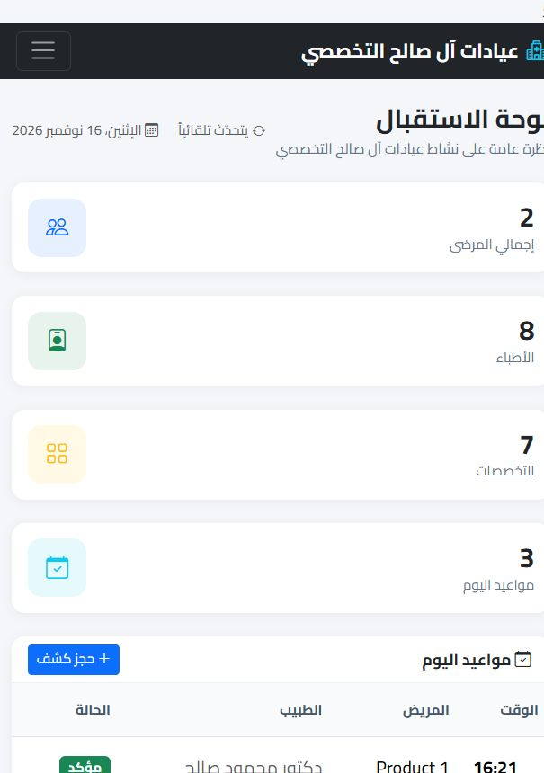
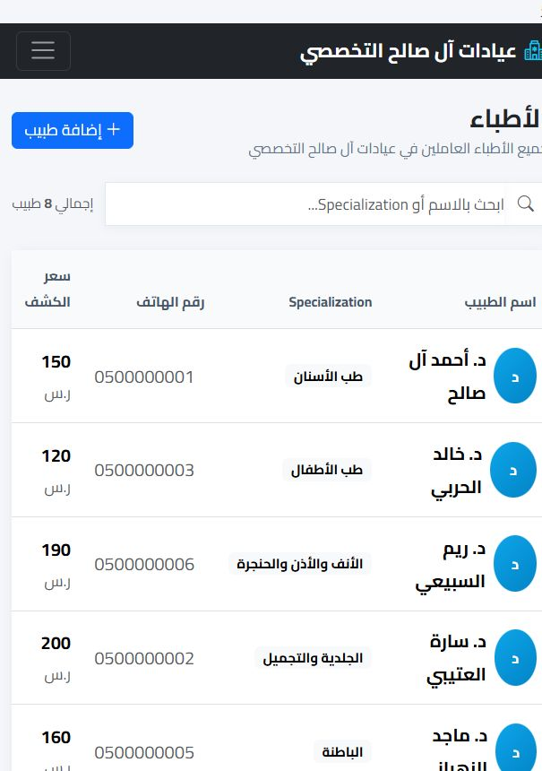

# نظام إدارة عيادات الأطباء — ASP.NET Core MVC


[](https://github.com/bodysale5678az-svg/hospital/actions/workflows/ci.yml)


نظام إدارة عيادات متكامل مبني بـ **ASP.NET Core MVC** و **Entity Framework Core**، بواجهة عربية كاملة من اليمين للشمال (RTL)، ومزوّد بنظام صلاحيات موحّد بثلاثة أدوار للدخول.

---

## لقطات الشاشة

### لوحة الاستقبال


### التخصصات


### الأطباء


### حجز كشف مع التحقق من ساعات العمل


---

## المميزات

### إدارة العيادة
- **التخصصات** — إضافة وتعديل وحذف، مع عدّاد أطباء لكل تخصص.
- **الأطباء** — إضافة وتعديل وحذف، مع قائمة تخصص ورسوم كشف وصورة شخصية.
- **المرضى** — إضافة وتعديل وحذف، مع السن والنوع وقائمة المواعيد.
- **الحجوزات** — إضافة وتعديل وحذف، مع حالات ملوّنة.

### نظام الدخول والصلاحيات
- **تسجيل حسابات** بثلاثة أنواع: مدير، طبيب، مريض.
- **ثلاث لوحات منفصلة** حسب الدور:
  - `/Admin` — لوحة المدير: إدارة المستخدمين والأدوار وربط الحسابات.
  - `/DoctorArea` — لوحة الطبيب: مواعيده فقط.
  - `/PatientArea` — لوحة المريض: بياناته ومواعيده، مع تعديل ذاتي وإلغاء مواعيد.
- **حماية كل صفحة حسب الدور** عبر `[Authorize(Roles = ...)]`.
- **معالجة قصص الحافة** — أي حساب جديد من نوع مريض يُنشأ له ملف مريض تلقائياً فور التسجيل.
- **دعم الثقة الكاملة** — إخفاء روابط القائمة الجانبية عن الزائر غير المسجّل.

### التحقق من المواعيد (من جهة الخادم)
- منع الحجز خارج ساعات العمل.
- منع الحجز يوم الجمعة.
- منع الحجز خلال فترة الراحة.
- منع الحجز في وقت ماضي.
- منع الحجز المزدوج لنفس الطبيب في نفس الوقت.

### واجهة المستخدم
- **عربية بالكامل** مع خط Cairo وتخطيط RTL.
- **متجاوبة** — قائمة جانبية تتحوّل على الشاشات الصغيرة.
- **بحث فوري** في التخصصات والأطباء والمرضى.
- لوحة استقبال بإحصائيات مباشرة ومواعيد اليوم وأحدث الحجوزات.

---

## التقنيات المستخدمة

| الطبقة | التقنية |
|---|---|
| الخادم | ASP.NET Core MVC (.NET 10) |
| قاعدة البيانات | Entity Framework Core + SQL Server |
| المصادقة | ASP.NET Core Identity |
| الواجهة | Razor + Bootstrap 5 + Bootstrap Icons |
| الخطوط | Cairo (Google Fonts) |
| الأتمتة | GitHub Actions (بناء تلقائي) |

---

## نموذج البيانات

```
Specialization 1 ---- * Doctor 1 ---- * Appointment * ---- 1 Patient
                                            |
                                     ClinicSettings (سجل واحد)

ApplicationUser ---- PatientId ----> Patient
ApplicationUser ---- DoctorId -----> Doctor
```

- **Specialization → Doctor**: واحد لمتعدد
- **Doctor → Appointment**: واحد لمتعدد
- **Patient → Appointment**: واحد لمتعدد
- **ClinicSettings**: سجل إعدادات واحد لساعات العمل
- **ApplicationUser → Patient / Doctor**: ربط حساب الدخول بالملف الطبي

---

## هيكل المشروع

```
hospital/
├── Controllers/     → Home, Specialization, Doctor, Patient, Appointments,
│                      Account, Admin, DoctorArea, PatientArea
├── Models/          → Specialization, Doctor, Patient, Appointment,
│                      ClinicSettings, ApplicationUser
├── Data/            → ApplicationDbContext
├── Views/           → Razor views (RTL عربي)
├── Migrations/      → EF Core migrations
├── Services/        → خدمات مساعدة
└── wwwroot/         → CSS, JS, Bootstrap, خطوط
```

---

## التشغيل

### المتطلبات
- .NET 10 SDK
- SQL Server (نسخة Express كافية)

### الخطوات

```bash
# 1. اضبط سلسلة الاتصال في appsettings.json
# 2. طبّق المايغريشنز
dotnet ef database update

# 3. شغّل المشروع
dotnet run
```

سلسلة الاتصال الافتراضية:

```
Server=.;Database=AlSalehClinicsDb;Trusted_Connection=True;MultipleActiveResultSets=true;TrustServerCertificate=True
```

### أول حساب
أول حساب يُسجَّل في النظام يصبح **مديراً** تلقائياً. بعدها سجّل حسابات طبيب أو مريض من الصفحة نفسها باختيار النوع.

---

## الأدوار والصلاحيات

| الصفحة | مدير | طبيب | مريض | زائر |
|---|:---:|:---:|:---:|:---:|
| `/` لوحة الاستقبال | ✅ | ✅ | ✅ | ❌ |
| `/Patient` سجل المرضى | ✅ | ✅ | ✅ | ❌ |
| `/Doctor` الأطباء | ✅ | ✅ | ✅ | ❌ |
| `/Admin` لوحة المدير | ✅ | ❌ | ❌ | ❌ |
| `/DoctorArea` لوحة الطبيب | ❌ | ✅ | ❌ | ❌ |
| `/PatientArea` لوحة المريض | ❌ | ❌ | ✅ | ❌ |

---

## ما تعلّمته من المشروع

- هيكلة تطبيق MVC متعدد الكنترولرات مع Layouts و Partials مشتركة.
- استخدام `Include()` و `ThenInclude()` للتحميل المسبق للكيانات المرتبطة.
- التحقق من قواعد العمل في الخادم (ساعات العمل، الإجازات، التداخل).
- بناء واجهة **RTL عربية** كاملة مع Bootstrap 5.
- دمج ASP.NET Core Identity مع أدوار مخصّصة وربطها بجداول العمل.
- الفرق بين `[Authorize]` المتعددة (AND) و `Roles = "A,B"` في سمة واحدة (OR).
- حماية البيانات الحساسة بتقييد الوصول حسب هوية المستخدم لا حسب معرّف في الرابط.
- استخدام `TempData` لرسائل النجاح والخطأ عبر عمليات إعادة التوجيه.
- حماية الحذف من قيود المفاتيح الأجنبية.

---

## الترخيص

هذا المشروع مرخّص تحت **MIT License** — راجع ملف [LICENSE](LICENSE).

---

## المساهم

**Mahmoud Saleh** — [@bodysale5678az-svg](https://github.com/bodysale5678az-svg)
